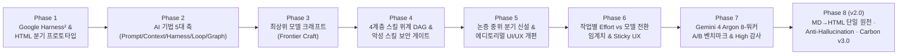

# HTML Branching Rule & Model-Effort Router v2.0 (`html-rule-harness`)

> **Google Harness² (`google-research/harness2`, `arXiv:2610.14224`) · Markdown 단일 원천 → 결정적 HTML 뷰(`md-html-guide`) · 5계보 환각 방지 가드레일(`antigravity-gemini-anti-hallucination`) · Gemini 4 Carbon/Argon/Neon/Hydrogen v3.0 동적 라우터**

---

## 1. 문제 제기 (Problem Statement)

### ① 범용 하네스(General-Purpose Harness)의 작업별 비효율과 컨텍스트 희석
최근 AI 에이전트를 제어하기 위한 다양한 제품용·범용 하네스(Harness)와 거대한 단일 지침서(`AGENTS.md`, `CLAUDE.md`, `.cursorrules`)들이 등장하고 있습니다. 그러나 이러한 하네스들은 **일반적인 적용(General-purpose application)**을 전제로 설계되어 있어, 개별 세부 작업의 특수성이나 난이도 편차에는 효과적이지 못한 경우가 많습니다.
특히 코딩, 디버깅, 논증, 리서치, 멀티에이전트 오케스트레이션 등 모든 규칙을 단일 프롬프트에 한꺼번에 주입하면 **불필요한 컨텍스트 소모(Context Bloat)**가 발생할 뿐 아니라, 무관한 도메인의 용어가 출력에 섞여 들어가는 **교차 분기 오염(Cross-Branch Bleed)**과 정작 지켜야 할 핵심 지침이 묻히는 **주의력 희석(Attention Dilution / Lost-in-the-Middle)** 현상이 나타납니다.

### ② 무분별한 스킬(Skills) 생태계와 악성 스킬 위협·체계화 부재
SNS, 커뮤니티, GitHub 등에서는 바이브 코더(Vibe Coders)와 에이전트 사용자를 겨냥해 수많은 스킬 모음(Awesome Skills류 저장소)이나 개별 스킬이 경쟁적으로 홍보되고 있습니다. 하지만 실제 생태계를 뜯어보면 두 가지 심각한 한계가 존재했습니다.
1. **위계(Hierarchy)와 분기(Branching)의 부재**: 수십~수백 개의 스킬을 평면적으로 모아두기만 했을 뿐, 어떤 작업 단계(`Plan → Execute → Verify`)에서 어떤 스킬이 선행(`requires`)되어야 하고 어떤 스킬끼리 충돌(`conflicts_with`)하는지에 대한 구조적 체계가 없어 도구 선택 정확도가 급격히 무너집니다(`arXiv:2601.04748`).
2. **악성(Malicious) 스킬의 혼입 위험**: 외부에서 검증 없이 가져온 스킬 내부에 프롬프트 인젝션(`Ignore previous instructions`), 자격증명·환경변수(`~/.ssh`, `.env`, API 키) 탈취, 난독화 페이로드, 무단 외부 전송(`curl | sh`, 웹훅 유출) 등이 숨겨져 있는 사례가 보고되고 있어, 스킬 실행 전 이를 정적으로 검역(Quarantine)하고 차단할 보안 게이트가 필수적이었습니다.

---

## 2. 경험적 동기 (Empirical Motivation — 실제 시행착오에서 얻은 통찰)

실제 AI 작업의 효용성을 검증하는 과정에서 처음에는 **최상위 프론티어 모델(Top-tier Model)**을 고정하고 추론 강도를 최고치(**`ultra` effort**)로 설정해 모든 과제를 처리해 보았습니다. 그러나 실제 운용 결과 뚜렷한 병목이 드러났습니다.

* **과잉 추론(Overthinking)으로 인한 지연과 토큰·쿼터 폭주**: 단순 요약이나 명확한 스키마 수정 같은 하위 작업에서도 최고 모델과 `ultra` effort를 그대로 쓰니 추론 시간이 지나치게 길어지고 토큰 사용량과 쿼터 소모가 감당하기 어려울 만큼 급증했습니다.
* **하위 모델 하향 및 적정 Effort(`high`) 조정 실험**: 작업을 세부 단위로 뜯어보고 *"이 하위 작업은 하위 모델이나 낮은 Effort로 내려도 충분하지 않을까?"* 판단하여 실험해 본 결과, 추론 속도가 비약적으로 빨라지면서도 결과 품질에는 손실이 없었습니다. 나아가 진짜 상위 모델이 필요한 고난도 검증 구간에서도 무작정 `ultra` 하나에만 의존하기보다 **`high` 수준의 적정 Effort**로 처리했을 때, 결과물 수준에는 유의미한 차이가 없으면서 전체 작업 속도와 쿼터 효율은 압도적으로 개선되었습니다.
* **핵심 아이디어의 도출**: 이 경험을 통해 **"애초에 처음부터 큰 작업을 세부 하위 작업으로 분류해 두고, 각 하위 작업의 난이도와 성격에 알맞은 최적의 모델 티어(`low / mid / high`)와 추론 강도(`Effort: low / medium / high`)를 자동으로 권장받거나 즉시 배치할 수 있는 시스템"**이 필요하다는 결론에 도달했습니다.

---

## 3. 제안 방법 (Proposed Solution — 우리가 구축한 전체 시스템)

위의 **문제 제기(범용 하네스의 한계 + 무분별·악성 스킬 문제)**와 **경험적 발견(작업별 모델·Effort 차등 배분의 효용)**을 결합하여, 본 저장소는 AI가 수행하는 유즈케이스를 체계적으로 분류(Sort)하고 작업마다 필요한 **기법·방어 규칙·모델 조합·Effort·검증 스킬**을 단일 분기로 자동 라우팅하는 **HTML 분기형 규칙 및 모델·Effort 라우터(`html-rule-harness`)**를 제안하고 구현했습니다.

1. **Markdown 단일 원천(`rules/src/**/*.md`) → 결정적 컴파일 HTML 뷰(`rules/router.html` & 28개 분기 노드, v2.0 `md-html-guide`)**:
   - **MD Source of Truth + AI 컨텍스트 최소화 (94%~98% 절감)**: 모든 권위 있는 규칙은 YAML Frontmatter + Markdown(`rules/src/**/*.md`, 총 `45,916 B`)으로 작성하며, `scripts/build_rules_html.py`가 **0 LLM 토큰**으로 사람용 HTML 뷰(`73,564 B`)와 `rules/assets/tree-data.js`를 결정적으로 컴파일합니다. `scripts/resolve_rule.py`는 에이전트 호출 시 HTML 뷰 대신 **MD 원본을 1순위로 파싱**(HTML 자동 폴백)해 일치하는 단일 분기 체인(`Depth 0 → Depth 3`)만 `<active_rule_packet>`으로 추출합니다.
   - **인간 친화적 인터랙티브 Explorer UI (`rules/index.html`) + Export Loop**: Warm Stone Paper(`#F6F5F0`) & Forest Teal(`#0F766E`) 기반 모던 에디토리얼 워크벤치 UI(Sticky 시뮬레이터, `MD Source → HTML View` 단일 원천 배지·안내 배너, **`JSON 설정 내보내기`** / **`Markdown 규칙 패킷 내보내기`** / XML 복사 버튼, Markdown 원본 커스텀 빌더)를 제공합니다. 상업적 무료 오픈소스 에셋(**Lucide Icons**, **Pretendard Variable**, **IBM Plex Sans KR**, **JetBrains Mono**)만 사용하며 라이선스 크레딧을 투명하게 번들링했습니다.
2. **AI 유즈케이스 5대 기법 분류 및 복합 레시피 & 최상위 크래프트(`Frontier Craft`) 분기**:
   - 작업을 5대 도메인(**논증·기획 `reasoning`**, **코드·디버깅·아키텍처 `coding`**, **문헌·RAG 리서치 `research`**, **AI 유즈케이스 기법 스택 `ai-systems`**, **메타·스킬·보안·환각 방지 `meta`**)으로 분류합니다.
   - 특히 각 작업이 **5대 엔지니어링 기법(`Prompt`, `Context`, `Harness`, `Loop`, `Graph`)** 중 무엇을 핵심 축으로 써야 하는지, 언제 복합 기법(`Prompt + Harness + Loop`, `Context + Loop`, `Harness + Loop + Graph`)을 조합해야 하는지, 그리고 최상위 프론티어 모델이 요구되는 **탁월한(Exceptional) 비주얼·아키텍처 크래프트(`frontier-craft`)**에서 프롬프트 유발 토큰 낭비(`arXiv:2608.01347`)와 시각 패턴 완성 편향(`Pattern over Pixels`)을 어떻게 방어할지 명시합니다.
3. **작업별 '동일 모델 Effort 우선 조정 vs. 모델 티어 전환' 실증 정책 & Gemini 4 v3.0 카탈로그 (`model-catalog.json` v3.0)**:
   - 현역 검증 모델군으로 전면 업그레이드했습니다(구세대 레거시 1.x/2.x 모델 0건): **Low**(`gemini-3.5-flash-lite`, `gemini-3.8-flash`, `gemini-decision-1` v1beta Decisions API), **Mid**(`gemini-4-hydrogen` [기본 `high`, `xhigh` 지원, `minimal`·명시적 캐싱 미지원], `gemini-4-neon`), **High/Frontier**(`gemini-4-carbon` & `gemini-4-argon` [1M 통합 윈도우, `low`/`medium`(기본)/`high`, `xhigh`·`minimal`·명시적 캐싱·픽셀 세그멘테이션 미지원, Long Decode `background=True` + `max_output_tokens > 65536`, `total_input_tokens` 압축 트리거 금지]).
   - 논증 작업이라 해서 무조건 하위 모델(`low`)에만 묶지 않고, **단순 3줄 요약(`low/low`, 과잉 추론 억제)** → **찬반 균형·숨은 가정·반론 재반박(`mid/medium`, 아첨·확증 편향 방어)** → **상충 문헌 교차 종합(`high/high`)**으로 세분화했습니다.
   - 또한 학술 실증(`arXiv:2408.03314`, `arXiv:2510.27042`, `arXiv:2606.28661`, `arXiv:2603.14635`)을 바탕으로 **4대 적응 정책**을 구현했습니다:
     - `effort-first-with-verifier`: 단위 테스트·스키마 등 **외부 검증기가 존재할 때(`has_verifier=True`)** 경계 난이도나 1회 실패 시 상위 모델 전환보다 **동일 모델 내 Effort 상향(`low→medium`, `medium→high`)**을 우선 적용 (`raise_effort`).
     - `Modal Ceiling` 모델 전환: **외부 검증기가 없거나(`--no-verifier`)**, 2회 이상 연속 실패, 4개 이상 파일 결합, 동시성/보안 경계 감지 시에는 하위/중위 모델의 역량 한계(Modal Ceiling)에 갇히지 않도록 **상위 모델 티어로 즉시 전환** (`switch_model_up`).
     - `grounding-over-thinking`: 사실 조회·RAG에서 근거가 모호할 때는 추론 Effort만 높이면 과잉 확신과 환각이 증가하므로 **쿼리 재작성·리랭커(Re-ranker) 검색 보강**을 우선 권고 (`ground_before_think`).
     - `overthinking-guard-low`: 단순 추출·빠른 편집에서는 과잉 추론 역전(`arXiv:2504.13367`)을 막기 위해 `low / low`를 유지 (`keep_optimal`).
   - 아울러 규칙에 표기된 모델명은 **참고용 예시(`reference_examples`)**임을 명시하여, 실제 호출 시에는 사용자의 실행 환경과 잔여 쿼터에 맞는 런타임 모델·Effort로 매핑하도록 안내합니다.
4. **4계층 스킬 위계 DAG (`skill-hierarchy.json` v2.0), 악성 스킬 보안 검역 & 5계보 Anti-Hallucination 가드레일**:
   - 평면적 스킬 나열을 탈피해 **`Tier 0 (Security Quarantine Gate) → Tier 1 (Lifecycle & Architecture) → Tier 2 (Domain Execution) → Tier 3 (Deterministic Verifier: claim-verify, anti-hallucination-guard)`** 4계층 위계(총 9개 로컬 스킬)와 상호배타(`conflicts_with`) 규칙을 정의했습니다.
   - `rules/src/branches/meta/anti-hallucination.md` (`meta.anti-hallucination`) 및 `.agents/skills/anti-hallucination-guard/SKILL.md`를 통해 `antigravity-gemini-anti-hallucination`의 **공통 4대 원칙**(도구 우선 검증·역환각 금지, 선 원문 발췌+`#L` 인용, 모름의 권한·거짓 전제 교정, 실행 기반 검증), **5대 계보 수칙**(Flash/Lite, Hydrogen, Neon, Argon, Carbon), **Tier 0–2 결정론적 팩트체크**(`ref-fact-checker`)를 라우터와 UI 프리셋에 통합했습니다.
   - `scripts/scan_skills_security.py`가 모든 9개 스킬을 실행 전에 정적 스캔하여 프롬프트 인젝션, 자격증명 탈취, 난독화 실행, 무단 원격 쉘 실행 패턴이 발견되면 즉시 차단(`exit 2`)합니다.
5. **실증 A/B 벤치마크 및 중단 복구 체크포인트 캐시 (`benchmark/`)**:
   - 복합 엔지니어링 대과제를 4개 세부 작업(`T1`~`T4`)으로 분기하여 **그룹 A(Google Harness² 단독 + `Gemini 4 Argon (Medium)` 단일 고정 + 비라우팅 전체 규칙)**와 **그룹 B(Google Harness² + HTML 분기형 규칙 + 작업별 `Argon Low/Medium/High` 동적 라우팅)**를 실측 비교하고, **`Gemini 4 Argon (High)`**로 양쪽 산출물의 정밀 품질과 토큰당 가성비를 감사했습니다.

---

## 4. 실증 A/B 벤치마크 요약 (`Gemini 4 Argon` 8-워커 실측 & `Argon High` 정밀 감사)

상세 실험 설계, 재현용 마스터 프롬프트, 워커별 트랜스크립트 토큰 로그 및 라인 단위 코드 감사는 [`benchmark/AB_BENCHMARK_REPORT.md`](./benchmark/AB_BENCHMARK_REPORT.md)와 [`benchmark/prompts/REPRODUCIBLE_PROMPTS.md`](./benchmark/prompts/REPRODUCIBLE_PROMPTS.md)에 전문 수록되어 있습니다.

| 핵심 비교 지표 (4개 세부 작업 `T1`~`T4` 합산) | 그룹 A (`Argon Medium` 고정 + 전체 규칙) | 그룹 B (HTML 분기 규칙 + `Argon Low/Med/High`) | 그룹 B의 실증 효과 (B vs. A) |
| :--- | :---: | :---: | :---: |
| **주입된 규칙 컨텍스트 합계 (4작업 누적)** | `74,816 tok` (`222,308 B`) | **`2,473 tok` (`8,903 B`)** | **-96.7% (`-72,343 tok` 절감)** |
| **실측 신규 입력 토큰 (`input_tokens`)** | `129,114 tok` | **`85,309 tok`** | **-33.9% (`-43,805 tok` 절감)** |
| **실측 캐시 읽기 토큰 (`cache_read_tokens`)** | `266,691 tok` | **`180,312 tok`** | **-32.4% (`-86,379 tok` 절감)** |
| **실측 총 소모 토큰 (`total_tokens`)** | `402,239 tok` | **`276,264 tok`** | **-31.3% (`-125,975 tok` 절감)** |
| **단순 논증(`T1`) 출력 토큰 및 소요 시간** | `1,431 tok` / `27.0초` | **`565 tok` / `17.0초`** | 출력 **-60.5%**, 시간 **-37.0% 단축** |
| **기본 자동 검증 점수 (`ab_harness.py`)** | `92 / 100점` | **`100 / 100점`** | **+8.0점 향상** |
| **`Argon High` 6차원 정밀 품질 점수 (`audit_quality_high.py`)** | **`71 / 100점`** | **`100 / 100점`** | **+29.0점 향상 (+40.8% 품질 우위)** |
| **총 토큰 1만 개당 정밀 품질 점수 (가성비 효율)** | `1.77 점 / 10K tok` | **`3.62 점 / 10K tok`** | **`2.05배` (+104.5%) 효율 향상** |
| **신규 입력 토큰 1만 개당 정밀 품질 점수** | `5.50 점 / 10K input tok` | **`11.72 점 / 10K input tok`** | **`2.13배` (+113.1%) 효율 향상** |

* **핵심 정성 발견 3가지 (`Gemini 4 Argon (High)` 코드·문서 감사)**:
  1. **교차 분기 용어 오염(Cross-Branch Bleed) 차단 (`T1`)**: 전체 규칙을 읽은 그룹 A는 논증 요약문에 무관한 타 분기 용어(`PreToolUse`, `Swarm/Graph`, `Context Rot`, `Unbounded Retry Loop`)가 섞여 들어간 반면, 단일 패킷만 읽은 그룹 B는 오염 **0건**으로 5줄 안에 핵심 논증을 압축했습니다.
  2. **동일 모델(`Argon Medium`)에서 주의력 희석(Lost-in-the-Middle) 방지 (`T3`)**: `T3`는 양쪽 모두 동일한 `gemini-4-argon-medium`을 썼으나, 그룹 A는 27개 파일 분량 규칙 속에서 *"경계값 회귀 테스트를 추가한다"*는 지침을 놓쳐 테스트 파일을 1줄도 수정하지 않은 반면(`18/25점`), 그룹 B는 총 토큰을 **33.8% 아끼면서도** 4종 경계값 회귀 테스트(`test_boundary_regression_conditions`)를 정확히 추가했습니다(`25/25점`).
  3. **고난도 비동기 동시성에서 주석 및 컨텍스트 스위치(`sleep(0)`) 보존 (`T4`)**: 그룹 A(`Argon Medium`)는 수정 과정에서 시드 주석 5줄과 임계 구역 내 이벤트 루프 양보 코드(`await asyncio.sleep(0)`)를 임의로 삭제한 반면(`14/25점`), 그룹 B(`Argon High` + `coding.debugging.concurrency`)는 총 토큰을 **44.7% 절감**하면서도 시드 주석과 `await asyncio.sleep(0)`을 `async with self._lock:` 내부에 100% 보존하고 5단계 6열 상태 전이·락 순서·취소(`CancelledError`) 경계표를 완성했습니다(`25/25점`).

---

## 5. 역할 분담 및 기여 내역 (Contributors & Role Division)

본 프로젝트는 첫 설계부터 아키텍처 확장, 학술 근거 검증, UI/UX 개편, 그리고 실증 A/B 벤치마크까지 **Human Architect (`@devshin-91`)**와 **AI Engineering Partner (`@antigravity-bot`, Google Antigravity)**의 긴밀한 페어 프로그래밍으로 완성되었습니다.

| 구분 | 기여자 (Contributor) | 핵심 역할 및 주요 기여 (Contributions Across Conversation) |
| :--- | :--- | :--- |
| **Lead Architect & Product Vision** | **[@devshin-91](https://github.com/devshin-91)** | • **핵심 아키텍처 발상**: AI 컨텍스트 최소화와 인간 가독성을 동시에 만족하는 **HTML 기반 계층형 분기 규칙** 및 작업 난이도별 모델·Effort·스킬 자동 라우팅 개념 최초 제안<br>• **8단계 연구·검증 프로토콜 설계**: Google Harness² (`AGENTS.md`, `rules.md`, `progress.md`, `reference.md`, `tradeoff.md`) 기반 워크플로우 및 막힘 발생 시 다중 출처(GitHub/웹/Liner Scholar) 순환 해결 규칙 수립<br>• **도메인 및 보안 확장 디렉션**: (1) Prompt/Context/Harness/Loop/Graph 5대 AI 유즈케이스 기법 및 복합 조합 반영 지시, (2) SNS/커뮤니티의 최상위 모델 활용 크래프트(`Exceptional` = 뛰어난/탁월한 결과물) 분기 제안, (3) 평면적 스킬 모음의 한계 지적 및 **스킬 위계 구조화 + 악성(Malicious) 스킬 차단** 지시<br>• **모델·Effort 실증 교정**: "논증도 난이도에 따라 중위 모델이나 Effort 조정이 필요하다"는 비판적 검증 지시 및 작업별 모델 변경 vs. Effort 상향 기준 조사 주도<br>• **UI/UX 및 실용성 디렉션**: AI slop 탈피 및 상업적 무료 오픈소스 에셋 적용(라이선스 크레딧 명시), 우측 시뮬레이터 스크롤 고정(Sticky UX), 수동 선택 해제 직관적 문구 개편, 런타임 가용 모델 매핑 및 일반 기준선 한계 고지문 설계<br>• **실증 A/B 벤치마크 & 감사 설계**: `Gemini 4 Argon (Medium)` 기준선 대비 동적 라우팅 A/B 테스트, 쿼터 중단 대비 체크포인트 캐시, 재현 가능 프롬프트 명세화, `Gemini 4 Argon (High)` 기반 산출물 품질·효용성 교차 감사 총괄 |
| **AI Systems Engineering & Verification** | **[@antigravity-bot](https://github.com/antigravity-bot)**<br>*(Google Antigravity)* | • **Google Harness² 스캐폴드 및 27개 HTML 분기 트리 구현**: `rules/router.html` 및 5대 도메인 26개 하위 HTML 분기 노드, `<!-- AI-RULE-START/END -->` 시맨틱 파서 및 단일 `<active_rule_packet>` 생성기(`scripts/resolve_rule.py`) 구현<br>• **6차에 걸친 학술·생태계 리서치 수행**: GitHub, 기술 문서, Liner Scholar 학술 검색을 통해 총 40여 편의 최신 논문(`arXiv:2610.14224`, `2605.29270`, `2510.27042`, `2606.28661`, `2601.04748` 등)을 조사하고 라우팅 수식과 임계치로 코드화<br>• **4계층 스킬 DAG 및 정적 보안 스캐너 구현**: `rules/skill-hierarchy.json`, 8개 로컬 스킬(`.agents/skills/`), 프롬프트 인젝션·자격증명 탈취·원격 실행 차단기(`scripts/scan_skills_security.py`) 및 12개 단위 테스트(`tests/test_rules_harness.py`) 작성<br>• **에디토리얼 워크벤치 UI/UX 구현**: Warm Stone Paper 테마(`rule-ui.css`), Python-JS 라우팅 엔진 동기화(`rule-ui.js`), Sticky 시뮬레이터 패널, 오픈소스 폰트·아이콘 라이선스 번들(`rules/assets/licenses/`) 구축<br>• **8-워커 병렬 A/B 벤치마크 & `Argon High` 정밀 감사 실행**: `benchmark/ab_harness.py`, `benchmark/audit_quality_high.py`, 체크포인트 캐시(`ab_checkpoint.json`) 및 최종 벤치마크 리포트(`AB_BENCHMARK_REPORT.md`) 작성 |

---

## 6. 단계별 개발 히스토리 (Development History: Phase 1 ~ Phase 8)

대화 시작부터 v2.0 아키텍처 리팩토링까지 총 8단계(Phase 1~8)의 점진적 반복(Propose–Probe–Compose)을 거쳐 발전했습니다.



| 단계 | 핵심 마일스톤 및 해결 과제 | 주요 산출물 및 검증 지표 |
| :--- | :--- | :--- |
| **Phase 1**<br>*(초기 아키텍처)* | • Google Harness² (`AGENTS.md <= 8,000자`, `rules.md`, `library/`) 스캐폴드 구축<br>• AI가 읽는 `<!-- AI-RULE-START/END -->`와 사람이 보는 UI DOM을 분리해 AI 블록 상한(`<= 2,800B`) 돌파 | `AGENTS.md`, `rules/router.html`, `scripts/resolve_rule.py`, `scripts/validate_harness.py` |
| **Phase 2**<br>*(AI 기법 5대 축)* | • AI 유즈케이스 핵심 기법인 **Prompt / Context / Harness / Loop / Graph** 5대 분기 및 복합 조합 레시피(`combo-recipes.html`) 신설 | `rules/branches/ai-systems/*.html`, `reference/ai-usecases-pillars.md` |
| **Phase 3**<br>*(Frontier Craft)* | • GitHub 외 블로그·SNS·커뮤니티의 최상위 모델 활용 사례 조사 및 프롬프트 유발 토큰 낭비(`arXiv:2608.01347`), 패턴 완성 편향 방어 규칙 수립 | `rules/branches/ai-systems/frontier-craft.html`, `.agents/skills/frontier-craft/` |
| **Phase 4**<br>*(스킬 위계 & 보안)* | • 평면적 스킬 모음의 한계를 극복하는 **4계층 스킬 DAG(Tier 0~3)** 설계<br>• 프롬프트 인젝션·시크릿 유출·난독화 실행을 잡는 정적 보안 스캐너 구현 | `rules/skill-hierarchy.json`, `scripts/scan_skills_security.py`, `reference/skills-hierarchy-and-security.md` |
| **Phase 5**<br>*(논증 보정 & UI 개편)* | • 논증 난이도 세분화: 반론·숨은 가정·설득 논증을 위한 중위 분기(`structured-argument.html`, `mid/medium`) 추가 및 `"예외적"` 오역을 `"탁월한/뛰어난"`으로 바로잡음<br>• AI slop 느낌과 화면 잘림을 없앤 Warm Paper 에디토리얼 UI 및 오픈소스 스톡 크레딧 반영 | `rules/branches/reasoning/structured-argument.html`, `rules/index.html`, `rules/assets/licenses/` |
| **Phase 6**<br>*(Effort vs 모델 전환 & UX)* | • 외부 검증기 유무(`has_verifier`)와 모달 천장(`arXiv:2606.28661`)에 기반한 **4대 작업별 Effort/모델 전환 정책** 구현<br>• 우측 시뮬레이터 스크롤 고정(Sticky UX), 수동 선택 해제 직관화, 런타임 모델 매핑 및 일반 기준선 한계 고지문 추가 | `rules/model-catalog.json` (v2.0), `reference/model-switching-and-effort.md`, `rules/assets/rule-ui.css` |
| **Phase 7**<br>*(실증 A/B 벤치마크)* | • `Gemini 4 Argon (Medium)` 단일 고정(그룹 A) vs 규칙 기반 `Argon Low/Medium/High` 동적 라우팅(그룹 B) 8-워커 실증 벤치마크 및 중단 복구 체크포인트 캐시 구현<br>• `Gemini 4 Argon (High)` 정밀 품질 감사로 **입력 토큰 -33.9%, 총 토큰 -31.3%, 정밀 품질 71→100점, 토큰당 가성비 2.05~2.13배** 입증 | `benchmark/ab_harness.py`, `benchmark/audit_quality_high.py`, `benchmark/AB_BENCHMARK_REPORT.md` |
| **Phase 8 (v2.0)**<br>*(MD→HTML · Anti-Hallucination · Carbon v3.0)* | • `md-html-guide` 적용: 28개 규칙을 Markdown 단일 원천(`rules/src/**/*.md`)으로 전환하고 `scripts/build_rules_html.py` (`--check`, 0 LLM 토큰)로 HTML 뷰·`tree-data.js` 결정적 컴파일 + Explorer UI **JSON / Markdown 내보내기 루프** 구축<br>• `antigravity-gemini-anti-hallucination` 통합: `meta.anti-hallucination` 분기 & Tier 3 `anti-hallucination-guard` 스킬(총 9개 스킬) 신설<br>• `model-catalog.json` v3.0 업그레이드: **Gemini 4 Carbon / Argon / Neon / Hydrogen / 3.5 Flash-Lite / Decisions API** 공식 스펙·Long Decode 규칙 반영 (레거시 1.x/2.x 0건, 단위 테스트 **17/17 OK**) | `rules/src/**/*.md`, `scripts/build_rules_html.py`, `rules/model-catalog.json` (v3.0), `.agents/skills/anti-hallucination-guard/`, `library/experiments/08-v2-md-source-carbon-refactor.md` |

---

## 7. 디렉터리 구조 및 빠른 시작 (Quick Start)

```text
html-rule-harness/
├── AGENTS.md                        # Google Harness² Always-on 루트 라우터 (5,395 / 8,000 chars)
├── rules.md                         # 8단계 연구·실행·검증 불변 프로토콜
├── rules/
│   ├── src/                         # [Single Source of Truth] 28개 Markdown + YAML 규칙 원본
│   │   ├── router.md                # AI 1순위 진입 루트 라우터 (Depth 0)
│   │   └── branches/                # 5대 도메인 27개 세부 Markdown 규칙 분기 (Depth 1~3)
│   │       ├── reasoning/           # 단순 논증(low), 찬반·반론 구조화 논증(mid), 심층 교차 종합(high)
│   │       ├── coding/              # 빠른 수정(low), 런타임 디버깅(mid), 동시성(high), 아키텍처(high)
│   │       ├── research/            # 단일 사실 확인(low), 다중 출처 감사(mid), 문헌 메타 종합(high)
│   │       ├── ai-systems/          # Prompt, Context, Harness, Loop, Graph, 복합 레시피, Frontier Craft
│   │       └── meta/                # 모델 정책, 스킬 위계, 악성 스킬 검역, 환각 방지(anti-hallucination), 커스텀 빌더
│   ├── index.html                   # 사람용 인터랙티브 MD→HTML 탐색기 & Export Loop 시뮬레이터 UI
│   ├── router.html                  # [Compiled] 결정적 컴파일 HTML 루트 뷰 (Depth 0)
│   ├── branches/                    # [Compiled] 결정적 컴파일 27개 HTML 분기 뷰 (Depth 1~3)
│   ├── model-catalog.json           # Gemini 4 Carbon/Argon/Neon/Hydrogen & 3.5/Decisions v3.0 카탈로그
│   ├── skill-hierarchy.json         # 4계층 스킬 위계 DAG 및 충돌 해결 정의 (v2.0, 9개 스킬)
│   └── assets/                      # UI 스타일시트, 라우팅·Export 엔진(rule-ui.js), tree-data.js, 라이선스
├── .agents/skills/                  # 보안 검증을 통과한 9개 계층형 로컬 스킬 (SKILL.md)
├── scripts/
│   ├── build_rules_html.py          # MD 단일 원천 -> HTML 뷰 & tree-data.js 결정적 컴파일러 (--check 지원)
│   ├── resolve_rule.py              # MD 우선(HTML 폴백) 단일 <active_rule_packet> XML/JSON/MD 라우터
│   ├── validate_harness.py          # Google Harness² 예산·MD-HTML 동기화·카탈로그·보안 통합 검증기
│   └── scan_skills_security.py      # 악성 스킬 정적 보안 검역기 (Tier 0 Gate)
├── benchmark/                       # 실증 A/B 벤치마크 하네스, 체크포인트 캐시, Argon High 감사기
│   ├── AB_BENCHMARK_REPORT.md       # A/B 벤치마크 & Argon High 정밀 감사 최종 리포트
│   ├── prompts/REPRODUCIBLE_PROMPTS.md # 누구나 복사해 재현할 수 있는 마스터/워커 프롬프트 명세
│   ├── ab_harness.py                # 워크스페이스 시드 초기화, 텔레메트리 수집, 체크포인트 기록기
│   ├── audit_quality_high.py        # 6차원 정밀 품질 및 토큰 가성비 감사 스크립트
│   └── cache/                       # 중단 복구 체크포인트(ab_checkpoint.json) 및 감사 결과
├── reference/                       # GitHub, 공식 문서, Liner Scholar 학술 논문(40+편) 정리
├── library/                         # Google Harness² Propose-Probe-Compose 반복 경험 로그 (Iter 01~08)
└── tests/                           # MD-HTML 패리티·라우팅·Effort·Anti-Hallucination·v3.0 스펙 단위 테스트 (17건)
```

### 주요 실행 커맨드

```powershell
# 1. Markdown 단일 원천 -> HTML 뷰 및 tree-data.js 결정적 컴파일 / 동기화 검증
python scripts/build_rules_html.py
python scripts/build_rules_html.py --check

# 2. 작업 설명과 난이도 신호에 따른 단일 <active_rule_packet> 추출 (MD 원본 1순위)
python scripts/resolve_rule.py --task "task_queue.py 런타임 오류 3건 디버깅 및 단위 테스트 통과" --files 2 --attempts 1 --format xml
python scripts/resolve_rule.py --task "Gemini 4 Carbon 환각 검증 및 근거 인용 감사" --format json

# 3. 외부 검증기(단위 테스트)가 없는 상태에서 모달 천장 회피용 상위 모델 전환 확인
python scripts/resolve_rule.py --task "코드 런타임 오류 디버깅" --files 2 --attempts 1 --no-verifier --format json

# 4. Google Harness² 아키텍처 예산 + MD-HTML 동기화 + 보안 스캔 + 단위 테스트(17건) + JS 문법 검증
python scripts/validate_harness.py
python scripts/scan_skills_security.py
python -m unittest discover -s tests -v
node --check rules/assets/rule-ui.js

# 5. A/B 벤치마크 검증 및 Argon High 정밀 품질 감사 재실행
python benchmark/ab_harness.py verify
python benchmark/audit_quality_high.py
```

---

## 8. 상업적 무료 오픈소스 에셋 및 라이선스 크레딧 (Open-Source Credits)

Explorer UI (`rules/index.html`)는 상업적 무료 사용이 검증된 오픈소스 폰트와 아이콘 스톡만을 사용하며, 라이선스 전문은 [`rules/assets/licenses/`](./rules/assets/licenses/) 및 [`reference/ui-ux-and-stock-credits.md`](./reference/ui-ux-and-stock-credits.md)에 포함되어 있습니다.

- **Lucide Icons (`v0.460.0`)** — ISC / MIT License (`rules/assets/licenses/lucide-LICENSE.txt`)
- **Pretendard Variable (`v1.3.9`)** — SIL Open Font License 1.1 (`rules/assets/licenses/pretendard-OFL.txt`)
- **IBM Plex Sans KR** — SIL Open Font License 1.1 (`rules/assets/licenses/ibm-plex-OFL.txt`)
- **JetBrains Mono** — SIL Open Font License 1.1 (`rules/assets/licenses/jetbrains-mono-OFL.txt`)
